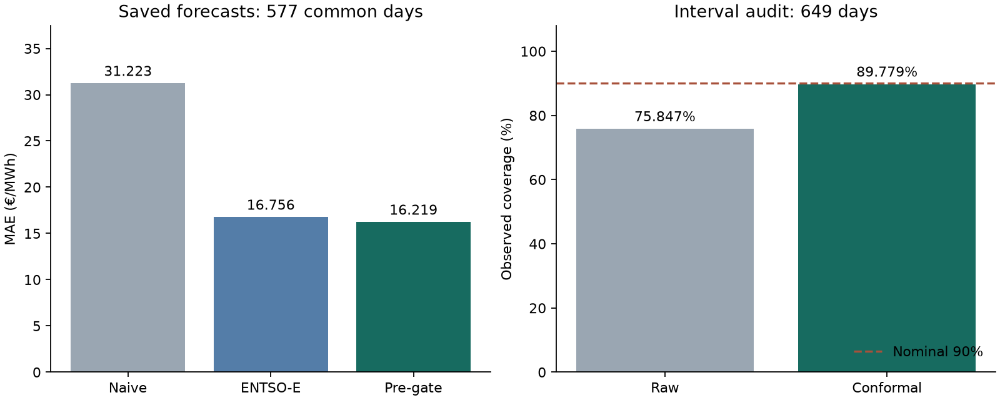

# DK1 probabilistic price forecasting

Forecast hourly day-ahead electricity prices for Western Denmark using market data, weather forecasts and calibrated prediction intervals.

**MAE: 16.219 €/MWh, 48.054% below the naive benchmark over 577 common evaluation days.** These are audited saved forecasts, not a new model fit.



## Quick start

From the repository root, reproduce the chart without downloading market data:

```bash
python3 -m venv .venv
.venv/bin/pip install -r requirements.txt
.venv/bin/python scripts/plot_results.py
```

To download inputs, export your own `ENTSOE_API_KEY` and run `bash scripts/download_data.sh`. Raw data and credentials are ignored; provider redistribution terms have not been established, so market samples are not bundled. The download requires ENTSO-E and Open-Meteo access.

## Method

- ENTSO-E prices, load forecasts and renewables forecasts; archived ECMWF weather through Open-Meteo.
- Previous-day weather runs target the pre-12:00 CET information set.
- Turbine curves and rolling regressions map weather to a renewables proxy.
- Naive, hourly Lasso and LightGBM quantile models; equal-weight ensemble.
- Conformal interval calibration uses earlier errors.
- One-sided Diebold–Mariano tests compare daily forecast losses.

## Results

[Verified metrics and input hashes](results/verified_metrics.json) support every figure below.

| Measure | Saved-result audit |
|---|---:|
| Naive / pre-gate MAE, €/MWh | 31.223 / 16.219 |
| Raw / calibrated nominal 90% coverage | 75.847% / 89.779% |
| Weather proxy R² against ENTSO-E forecast | 0.8805 |
| Pre-gate versus ENTSO-E price-ensemble pinball DM p | 0.00000170 |

MAE uses 577 common days within January 2025–August 2026; interval calibration uses 649 days within October 2024–August 2026. Proxy R² measures agreement with a renewables **forecast**, not observed generation.

## What didn't work

Raw intervals undercovered. Input publication vintages are incomplete, so strict historical availability remains unverified. Forecast accuracy does not establish trading profitability. The imbalance versus day-ahead spread study is still in progress.

## Tests, structure and licence

[](https://github.com/VChahar1/dk1-probabilistic-price-forecasting/actions/workflows/tests.yml)

CI compiles Python and regenerates the chart. There is no unit-test suite. `scripts/verify_saved_results.py` audits local cached forecasts; `test.py` diagnoses forecast coverage. `src/` contains models and downloads, `results/` contains saved evidence, and `assets/` contains the chart. Code: [MIT](LICENSE); source data retain their providers' terms.
